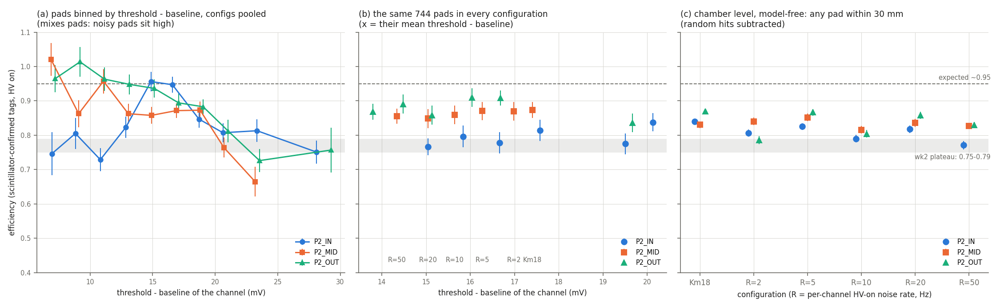

# Efficiency vs threshold, HV on: night 16/17 Nov and day ladder 17 Nov 2026

**Question (user):** as the threshold goes down, does the single-channel efficiency approach the ~95 % expected, or
does the VMM read-out of these detectors stay lower?

**Answer: it does not approach 95 % in the range covered (about 14 to 20 mV above baseline).** On the same pads,
lowering the threshold by about 5 mV changes nothing within errors: P2_MID 0.85-0.88, P2_OUT 0.84-0.92 (no trend),
P2_IN 0.77-0.84 (if anything lower at the lowest thresholds). A model-free chamber-level check (any pad within
30 mm) gives 0.77-0.87, also with no trend. The efficiency at the HV-on operating point is about **0.85**, higher than
in wk2 (0.75-0.79) but about 0.10 below 0.95. In this range the limit is not the threshold.

## Data and method

- Runs (HV on: IN 420/720, MID and OUT 430/730): night 231, 232, 234, 235 and day ladder 236-247 (12 x 50 min).
  **run_233 left out** (read-out fault from 06:25:30, HANDOFF_FAST_RATESCAN.md §11). 16 runs, ~11 h.
- Algorithm: **`channel_efficiency.py`, unchanged** (P2_basket_analysis, branch `eff-vs-threshold-distance`,
  codified 16 Nov, commit adcd169; method in `cosmic_vmm_analysis/CHANNEL_EFFICIENCY.md`). Scintillator-confirmed
  tags (H0 ch 40, 140-310 ns), counting estimator K(R) = eps E + b R^2, R_lo = 40 mm, clean = 40 mm.
  Closure tests passed on the box before running (test_channel_efficiency.py, toy: 0.85 -> 0.845-0.849).
- Run on the DAQ box (`~/eff_work/`; the data are not on EOS). The box has 7 GB of RAM, so each run is decoded
  in chunks of at most 85 MB of capture files (495 pseudo-runs, id = run x 100 + chunk; `scripts/make_chunks.py`);
  every chunk gets the run-level dead/masked list (`scripts/fix_dead.py`; the per-chunk lists were identical
  anyway, except in run_233).
- Threshold - baseline of every channel (`scripts/build_thr.py`): from each run's own ext file copy with the model
  of `bscan_target.py`, d = d_ref + (S - S_ref) k - (t - t_ref) step. References: `pilot/map_eq.json` (bscan
  files), `fastscan_20261116/full/map_start.json` (trimmed_Km18). Checks: Km18 = measured map exactly; bscan files
  realised - target = +0.55 mV median (0 to +1.05: trim rounding); night and day `hvon50` files are identical.

| configuration | runs | median d (mV) |
|---|---|---|
| trimmed_Km18_v1_hvm | 232 234 236 247 | 18.0 |
| bscan_hvon2 | 237 246 | 18.3 |
| bscan_hvon5 | 238 245 | 16.6 |
| bscan_hvon10 | 239 244 | 15.9 |
| bscan_hvon20 | 240 243 | 15.4 |
| bscan_hvon50 | 231 235 241 242 | 14.5 |

p10-p90 over all channels about 8.5-26 mV. The ladder spans only ~4 mV in the median: R = 100 Hz was left out
(over the rate guard).

## Results

**(b) The same 744 pads in every configuration** (`results/paired.csv`), eps +- ~0.025:

| config | P2_IN | P2_MID | P2_OUT |
|---|---|---|---|
| Km18 | 0.84 | 0.87 | 0.91 |
| R=2 | 0.78 | 0.87 | 0.84 |
| R=5 | 0.81 | 0.87 | 0.91 |
| R=10 | 0.78 | 0.86 | 0.86 |
| R=20 | 0.80 | 0.85 | 0.89 |
| R=50 | 0.77 | 0.86 | 0.87 |

R_lo = 56 mm adds about +0.01-0.02 (the scattering tails of the extrapolated chambers, as in wk2).

**Codified plateau (18-40 mV, same definition as wk2)**: IN 0.81 +- 0.015, MID 0.81 +- 0.018, OUT 0.83 +- 0.015
(R_lo 56: 0.82 / 0.81 / 0.83); wk2 0.75 / 0.75 / 0.79.

**(c) Chamber level, model-free** (`results/chamber_level.csv`): tags predicted within 6 mm of a clean live pad,
P(any pad within 30 mm) - the same in the sideband window: IN 0.77-0.84, MID 0.82-0.85, OUT 0.79-0.87. Pads
fired within 20 mm per detected muon: 1.04-1.07, so charge sharing inflates the counting estimator by at most ~5 %.

**Checks (CHANNEL_EFFICIENCY.md §3):** scintillator peak 150-275 ns, 99.7 % inside the window; R_lo scan flat
from 40 mm on MID, a slow rise (+0.01-0.02 to 56 mm) on IN/OUT; chi2/ndf 2 (MID), 3-6.5 (IN/OUT), as in wk2;
repeated runs agree (e.g. the four Km18 runs: IN 0.88-0.92, OUT 0.92-0.93); no blind pads in these files.

## Why the binned curve (a) is misleading

Pooled over configurations and binned in threshold - baseline, the curve rises to ~0.95 below 16 mV (OUT, MID).
That is pad selection, not threshold: the bscan files set each channel by its own noise, so a bin picks out
*which* pads are in it (quiet pads sit low, noisy ones high), and the per-chip efficiencies differ by up to a
factor of 2-4. On the same pads (b) the rise is absent.

## Open point: the per-chip spread (`results/by_chip_config.csv`)

Per chip the estimator gives 0.2-0.5 (chip 8, MID), 0.4-0.7 (chips 6, 7, 19) and above 1 (chips 3, 11, 12, 15:
1.1-1.5). These are reproducible (pass 1 vs pass 2: pull rms 0.83) and, for some chips, change between
configurations without following the threshold (chip 19: 0.43 at R=2, 0.78 at R=5, 0.45 at R=10). Values above 1
cannot be an efficiency: a per-chip geometry/mapping effect (channel position, pad area, or the tag chambers'
thresholds moving the predicted points) that the chamber totals average over. The chamber-level numbers agree
with the model-free check, so the conclusion above stands; the per-chip numbers should not be used until this is
understood (next: hit maps of chips 8 and 12 against the pad map, wk2 per-chip numbers for comparison).

## What would test the 95 %

- Thresholds below ~12 mV on the same pads need the noise tails cut first (R = 100 Hz was over the rate guard).
- The HV is at the low end of the nominal range; a gain scan (HV steps at a fixed threshold file) tests whether
  the ~0.85 is gain-limited.
- The low chips (6, 7, 8, 19), if real, cost about 0.05-0.1 per chamber on their own.

## Reproduce (on dedippce185, `~/eff_work`)

    export VMM_QA_DIR=/local/p2/DAQ_Control_VMM_Beam/vmm_qa MPLBACKEND=Agg
    venv/bin/python make_chunks.py pseudo $(seq 231 247)
    bash dump_all.sh                                  # channel_efficiency.py dump, 2 jobs, --mem 2800M (~1.5 h)
    venv/bin/python fix_dead.py pseudo tags; mv tags/*run233[0-9][0-9].* tags_excl_run233/
    venv/bin/python build_thr.py pseudo thr.csv
    venv/bin/python cva/channel_efficiency.py measure tags thr.csv out --scint 140:310 \
        --bins 0 6 8 10 12 14 16 18 20 22 26 34 60
    venv/bin/python regroup.py out pseudo cva; venv/bin/python checks.py out tags pseudo cva
    venv/bin/python final_fig.py out pseudo cva

`cva/` = `cosmic_vmm_analysis/` of P2_basket_analysis at `eff-vs-threshold-distance`; `venv/` = numpy 1.26.4,
pandas 2.2.3, scipy 1.14.1, matplotlib 3.9.4 (installed offline from wheels; the box has no PyPI access).
